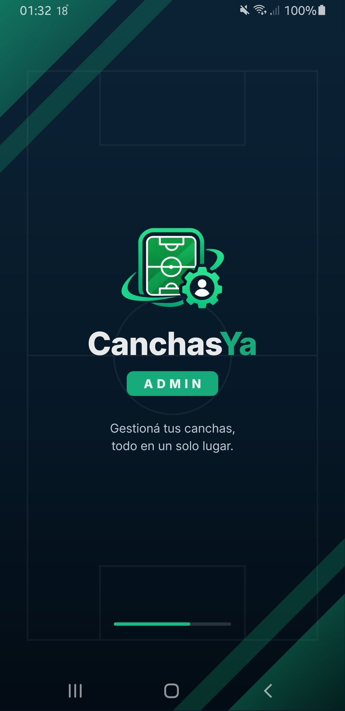
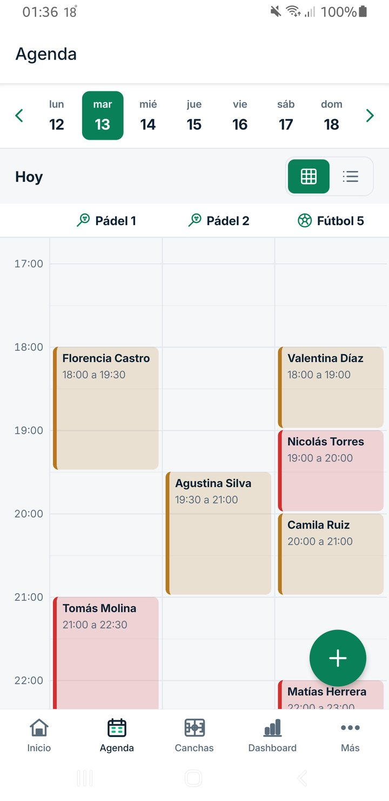
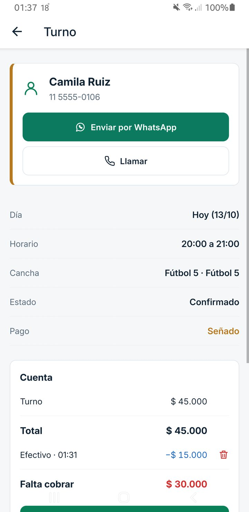
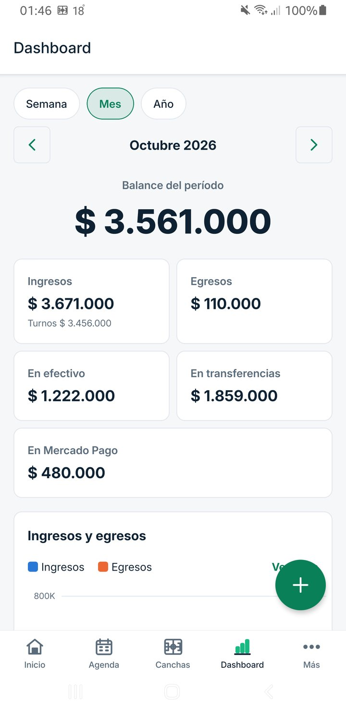

# CanchasYa Admin

App Android para que el dueño de un complejo de pádel y fútbol 5 administre todo desde el celular:
agenda de turnos, cobros, caja, estadísticas, empleados y torneos.

Proyecto de **Programación 3** · versión **1.0.0** · entrega del 26/10/2026.

<p align="center">
  
  
  
  
</p>

## Para evaluar el proyecto

| Qué | Dónde |
|---|---|
| **APK para instalar** | [Releases → v1.0.0](https://github.com/TheSegoxx/canchasya-admin/releases/tag/v1.0.0) (`CanchasYa-Admin-1.0.0.apk`) |
| **Manual de uso, arquitectura e instalación (PDF)** | [`docs/Manual-CanchasYa-Admin.pdf`](docs/Manual-CanchasYa-Admin.pdf) |
| **Capturas de todas las pantallas** | [`docs/capturas/`](docs/capturas) |
| **Datos de demostración** | `C:\xampp\php\php.exe backend\bin\datos-demo.php` (ver abajo) |

**Cuentas de demostración** (después de correr `datos-demo.php`):

| Rol | Email | Contraseña |
|---|---|---|
| Dueño | `demo@canchasya.test` | `demo1234` |
| Encargado | `encargado@canchasya.test` | `demo1234` |

El APK necesita la API corriendo en una computadora con XAMPP en el mismo WiFi: en el login,
**Servidor** permite escribir la IP de esa computadora (`ipconfig` → Dirección IPv4).

## Funcionalidades

- **Agenda:** grilla de canchas × horarios y vista lista, turnos fijos semanales, bloqueos (lluvia,
  mantenimiento) y confirmaciones o avisos por WhatsApp. No permite superponer turnos (control de concurrencia).
- **Cobros:** seña y saldo en efectivo, transferencia o **link de Mercado Pago**, extras (paletas,
  pelotas, bebidas) y caja del día.
- **Dashboard:** ingresos, egresos y balance por semana, mes o año, con gráficos y ocupación de las canchas.
- **Torneos y ligas:** fixture por sorteo, resultados, tabla de posiciones y partidos reservados en la agenda.
- **Encargados:** el dueño invita empleados con un código; operan la agenda y la caja, sin ver precios
  ni el dashboard (los permisos también los controla la API).
- **Notificaciones push:** turno nuevo o cancelado por otro del equipo, pago recibido por Mercado Pago,
  recordatorio 30 minutos antes de un turno que todavía debe plata y resumen de la caja al cierre.
- Fotos del complejo y de las canchas, tema claro u oscuro, login con email o Google y recuperación
  de la contraseña con un código por email.

## Tecnologías y estructura

**App:** React Native 0.87 (CLI) + TypeScript, React Navigation, Firebase Cloud Messaging, Google Sign-In,
gifted-charts, fuente Inter · Android 7.0 o superior.
**API:** PHP 8.2 sin framework (router, controladores, servicios y modelos propios) + MySQL/MariaDB sobre
XAMPP, JWT, PHPMailer, Mercado Pago Checkout Pro.

```
src/                 App (TypeScript)
  api/               cliente HTTP y una función por endpoint
  screens/           una carpeta por módulo (agenda, cobros, dashboard, torneos…)
  components/        botón, campos, íconos, galería, pantalla de carga…
  context/ theme/    sesión y roles; colores, fuente y modo claro/oscuro
backend/             API (PHP)
  public/index.php   punto de entrada (todo pasa por el router)
  src/rutas.php      las 63 rutas
  src/Controllers/   validación y permisos
  src/Services/      lógica: agenda, cobros, fixture, Mercado Pago, FCM, avisos
  src/Models/        acceso a cada tabla con consultas preparadas
  bin/               tareas de consola (avisos automáticos, datos de demostración)
  database/          schema.sql (22 tablas) y migraciones
docs/                manual en PDF y capturas
__tests__/           tests de Jest
```

## Puesta en marcha

1. **Base de datos:** con XAMPP encendido (Apache y MySQL):
   - Instalación nueva: importar `backend/database/schema.sql` (crea la base `canchasya` completa).
   - Base de una versión anterior: aplicar en orden los archivos de `backend/database/migraciones/`
     que falten (`mysql -u root < backend/database/migraciones/00X_....sql`). No borran datos.
2. **API:**
   - Copiar `backend/.env.example` como `backend/.env` y completar `JWT_SECRET`
     (`C:\xampp\php\php.exe -r "echo bin2hex(random_bytes(32));"`).
   - Opcional: `MP_ACCESS_TOKEN` con el Access Token de Mercado Pago (para los links de pago).
   - `MAIL_USUARIO` y `MAIL_CLAVE` con la cuenta que manda el código de "¿Olvidaste tu contraseña?"
     (en desarrollo, si quedan vacíos, los correos se guardan en `backend/storage/correos.log`).
   - Notificaciones push: en Firebase (Configuración del proyecto → Cuentas de servicio) generar una clave
     privada y guardarla como `backend/storage/firebase-cuenta-servicio.json`. Nunca va en la app ni en GitHub.
   - Ejecutar `composer install` dentro de `backend/`.
   - Crear el acceso desde XAMPP:
     `mklink /J C:\xampp\htdocs\canchasya <ruta del proyecto>\backend`
   - Probar con `http://localhost/canchasya/api/salud`.
   - **Datos de demostración** (opcional): `C:\xampp\php\php.exe backend\bin\datos-demo.php` crea las
     cuentas de demostración con complejo, canchas, turnos de hoy y de los próximos días, un mes de
     historial, gastos, un torneo y un encargado. Se puede volver a correr: rehace la demo con fechas actuales.
   - Avisos automáticos (recordatorios, pagos de Mercado Pago y resumen de caja): ejecutar una vez
     `backend\bin\instalar-avisos.bat`, que crea una tarea del Programador de tareas de Windows que corre
     `bin/avisos.php` cada minuto. Lo que envía queda en `backend/storage/avisos.log`.
3. **App:** la app de Android registrada en el mismo proyecto de Firebase (paquete `com.canchasamigos`)
   da el archivo `google-services.json`, que va en `android/app/`. Después: `npm install`, conectar el celular por USB con la depuración activada y ejecutar:

   ```sh
   adb reverse tcp:8081 tcp:8081   # Metro
   adb reverse tcp:8080 tcp:80     # API de XAMPP
   npm start
   npm run android
   ```

## APK para instalar (por WiFi)

El celular se conecta con la computadora de XAMPP por el mismo WiFi (sin cable).

1. **Firewall de Windows** (una sola vez, en PowerShell como administrador): permite que los
   dispositivos de la red local lleguen a Apache.

   ```powershell
   New-NetFirewallRule -DisplayName "CanchasYa - Apache (XAMPP)" -Direction Inbound -Protocol TCP -LocalPort 80 -Action Allow -RemoteAddress LocalSubnet
   ```

2. **Firma:** `android/app/canchasya-release.keystore` y `android/keystore.properties` (no se suben a
   GitHub; guardar una copia: sin ellos no se pueden publicar actualizaciones de la app).
3. **Login con Google en el APK:** en Google Cloud (Credenciales) tiene que existir un ID de cliente
   OAuth de tipo Android con el paquete `com.canchasamigos` y la huella SHA-1 de la llave de release
   (`keytool -list -v -keystore android/app/canchasya-release.keystore`).
4. **Compilar** (32 y 64 bits):

   ```sh
   cd android
   ./gradlew assembleRelease -PreactNativeArchitectures=armeabi-v7a,arm64-v8a
   ```

   El APK queda en `android/app/build/outputs/apk/release/app-release.apk`.
   Si falla con *"Filename longer than 260 characters"* (límite de Windows), compilar desde una
   unidad corta: `subst W: "<carpeta del proyecto>"` y correr el comando dentro de `W:\android`
   (después, `subst W: /D`).
5. La app trae la IP con la que se compiló (`src/servidor.ts`). Si la computadora cambia de IP
   (`ipconfig` → Dirección IPv4), se corrige desde el login → **Servidor**, sin volver a compilar.

## Pruebas

```sh
npm test          # Jest (34 tests)
npx tsc --noEmit  # tipos
npm run lint      # ESLint
```

## Seguridad

Contraseñas con bcrypt, sesión con JWT guardado en el Keystore de Android, consultas preparadas,
límite de intentos por IP, permisos verificados en la API en cada petición y secretos (Mercado Pago,
Gmail, Firebase, JWT) solo en `backend/.env` y `backend/storage/`, fuera del repositorio.
